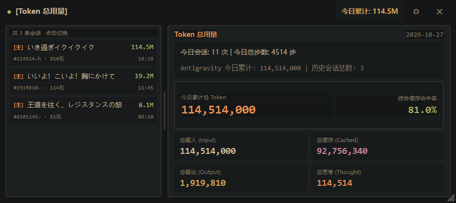

# Token HUD

[](https://github.com/GENSHINLY/Antigravity-token-hud/releases)
[](https://github.com/GENSHINLY/Antigravity-token-hud/releases)
[](https://opensource.org/licenses/MIT)

基于 PySide6 (Qt 6 单句柄 Alien Widgets 硬件加速渲染) 与 Windows 11 DWM API 实现的 **Antigravity / Gemini CLI / Claude Code 多源实时 Token 监控置顶悬浮窗**。开箱即用、自动探测多 Agent 会话日志，支持 Win11 原生圆角、DWM 毛玻璃（Mica / Acrylic）与逐像素半透明自定义主题，后台独立线程异步增量采集 JSONL 会话快照，UI 主线程零 I/O 阻塞。

<div align="center">



</div>

---

## v1.2 核心更新亮点

1. **模块化解耦架构**：将核心逻辑拆分为 `hud_core/` 模块化包（`config` / `parsers` / `pricing` / `monitor` / `win32_dwm` / `ui_widgets` / `settings_dialog` / `hud_window` / `selftest`），`token_hud.py` 精简为薄入口门面并保持 100% 向下兼容导出。
2. **Byte-Offset Tailing 增量日志文件读取**：记录每个 JSONL 会话文件的 `last_byte_offset`，通过 `seek(offset)` 仅解析新增行并累加至内存状态，消除每秒全量反序列化开销；文件截断或重写时自动回退全量重扫。
3. **自适应待机退避与隐藏暂停重绘**：连续 30 秒无任何日志文件修改时，轮询周期自动退避至 `3000ms`，一旦检测到新写入立即恢复高速周期；当悬浮窗处于最小化或隐藏状态时自动暂停 UI 控件重绘（`_render_snapshot`），恢复显示时即时全量重绘。
4. **跨天（00:00）零 I/O 内存归零**：跨越午夜 00:00 时直接在内存缓存中将所有会话的 `today_*` 计数与今日费用清零，无需重新读取磁盘上的全部历史 JSONL 文件。
5. **Pricing Engine 模型官方定价与今日折合成本展示**：内置 `TokenPricingEngine`，支持 **Google Gemini**（1.5/2.0/2.5/3.x/4 Argon）、**Anthropic Claude**（3 Opus/3.5/3.7/4.6）、**OpenAI**（GPT-4o / GPT-4o mini / o1 / o3-mini）与 **DeepSeek**（DeepSeek-V3 `deepseek-chat` / DeepSeek-R1 `deepseek-reasoner`）四大体系主流模型官方每百万 Token 分维费率（未缓存输入、缓存命中、输出、思考）与自定义费率，在主卡片、顶部标题栏徽章及侧边栏会话行实时展示今日折合与单会话折合费用（USD / CNY）。
6. **系统托盘常驻与 Win32 全局热键**：内置 `QSystemTrayIcon` 系统托盘图标与右键菜单（显示/隐藏、立即重新扫描、导出 CSV、设置、退出），并通过 Win32 `RegisterHotKey` 注册全局热键 `Ctrl+Alt+T` 一键唤起或隐藏悬浮窗。
7. **每日 Token 消耗持久化归档与一键导出 CSV 报表**：自动将每日各 Agent 与模型的 Token 消耗及折算费用持久化归档至 `~/.gemini/token_hud_history.json`，支持从系统托盘、右键菜单或设置面板一键导出包含 `Date,Agent,Model,InputTokens,CachedTokens,OutputTokens,ThoughtTokens,TotalTokens,CostUSD` 的标准 CSV 报表。

---

## 核心特性

### 1. 多 Agent 路由与开箱即用自动探测
- **主 Agent (Antigravity) 零配置探测**：启动后按优先级自动探测 Antigravity Brain 会话日志目录（自定义路径 -> `config.json` -> `$GEMINI_HOME/antigravity/brain` -> `~/.gemini/antigravity/brain`）。
- **子 Agent 动态发现与混排**：基于插件化注册表（`PARSER_REGISTRY`）原生支持 **Gemini CLI** (`~/.gemini/tmp`, `~/.gemini/chats`) 与 **Claude Code** (`~/.claude/projects`)。设置面板支持「自动扫描」一键定位本机已有的子 Agent 日志源。无启用子 Agent 时自动保持单 Agent 极简视图。
- **单日增量精准聚合**：按单步时间戳精准统计当天 00:00 之后的消耗增量，彻底解决跨天长会话累积历史数据污染今日统计的问题。

### 2. Win11 原生圆角与 DWM 毛玻璃材质
- **单句柄硬件加速架构**：全窗口仅顶层持有原生 Win32 `HWND`，内部子控件全部启用 Qt 6 Alien Widgets 硬件合成，消除多句柄闪烁与重排卡顿。
- **DWM 客户区扩展与材质集成**：通过 `dwmapi.dll` 调用 `DwmExtendFrameIntoClientArea`，支持沉浸式暗色模式 (`DWMWA_USE_IMMERSIVE_DARK_MODE`)、系统级圆角 (`DWMWCP_ROUND`) 与 Mica / Acrylic / Mica Alt 材质，配合逐像素 Alpha 与整窗透明度，通透呈现桌面光影。
- **双窗风格高度统一**：主悬浮窗与设置面板均采用无边框设计、自定义 34px 标题栏与平滑拖拽移动，数显区域无底色矩形色块。
- **二维响应式防裁切字号**：支持右下角无级拖拽缩放与双栏比例调节，内部大号数字、2×2 指标网格（输入/缓存/输出/思考）及左侧会话列表行高与字号随宽高双向自适应缩放。

### 3. 自定义主题与实时热重载
- **内置 4 套主题预设**：
  - `Gruvbox Material`（默认暖色复古暗黑）
  - `Cyberpunk Dark`（高对比霓虹暗黑）
  - `Catppuccin Mocha`（柔和粉彩暗色）
  - `纯黑 OLED`（纯黑底色低功耗对比）
- **全量 HEX 与拾色器定制**：支持针对主背景 (`bg_color`)、主文字 (`fg_color`)、强调色 (`accent_color`)、卡片背景 (`card_bg_color`)、边框颜色 (`border_color`) 输入 `#RRGGBB` 色值或调用 `QColorDialog` 可视化拾色器。
- **修改即生效（零确认/取消）**：在设置面板中切换主题、调整毛玻璃、修改路径或轮询频次，所有选项实时生效并同步持久化到本地配置文件，主界面与设置面板同屏联动刷新。

---

## 目录结构

- `token_hud.py`：顶层 CLI 入口门面（定义 `__version__ = "1.2.0"` 并重导出 `hud_core` 全部公开符号）。
- `hud_core/`：核心模块化包：
  - `config.py`：`ConfigManager` 配置中心、默认配置、脏数据清洗与 Antigravity 路径自动探测。
  - `parsers.py`：Antigravity / Gemini CLI / Claude Code 三类解析器与 Byte-Offset 增量读取实现。
  - `pricing.py`：`TokenPricingEngine` 模型官方定价表与 USD / CNY 费用折算引擎。
  - `monitor.py`：`TokenMonitorCache` 增量字节偏移缓存、跨天零 I/O 归零、历史记录归档与 CSV 报表导出。
  - `win32_dwm.py`：Windows 11 DWM 毛玻璃/圆角 API、DPI 感知与单实例互斥锁。
  - `ui_widgets.py`：响应式侧边栏会话行、双栏分隔条、右下角缩放手柄等自定义 Qt 组件。
  - `settings_dialog.py`：无边框实时热重载设置面板与子 Agent 状态探针。
  - `hud_window.py`：`TokenHUDWindow` 主悬浮窗、系统托盘、全局热键 `Ctrl+Alt+T` 与自适应待机调度。
  - `selftest.py`：`--self-test` 全链路非阻塞自动化自检套件。
- `hud_launcher.cs`：Windows 无控制台窗口启动器源码（C# `winexe` 子系统，支持动态探测脚本路径与单实例唤醒）。
- `build_launcher.ps1`：一键编译 `hud_launcher.cs` 生成本地 `hud.exe` 并同步至 `$env:USERPROFILE\.local\bin\hud.exe` 的构建脚本。
- `config.example.json`：样例配置文件。
- `README.md`：项目说明文档。

---

## 配置文件 `config.json` 结构与字段说明

程序优先读取同级目录下的 `config.json`，若不存在则回退读取 `~/.gemini/token_hud_config.json`。在设置面板中修改任何选项均会自动创建或更新配置文件。

### 示例配置

```json
{
  "main_agent_path": "",
  "sub_agents": [
    {
      "enabled": true,
      "name": "Gemini CLI",
      "path": "~/.gemini/tmp",
      "parser_type": "gemini_cli_session",
      "live_state_path": ""
    }
  ],
  "poll_interval_ms": 1000,
  "scan_ttl_sec": 2.5,
  "hotkey": "Ctrl+Alt+T",
  "usd_to_cny_rate": 7.25,
  "pricing": {
    "gemini-2.5-pro": {
      "input": 1.25,
      "cached": 0.125,
      "output": 10.0,
      "thought": 10.0
    },
    "claude-3.7-sonnet": {
      "input": 3.0,
      "cached": 0.3,
      "output": 15.0,
      "thought": 15.0
    },
    "gpt-4o": {
      "input": 2.5,
      "cached": 1.25,
      "output": 10.0,
      "thought": 10.0
    },
    "deepseek-chat": {
      "input": 0.27,
      "cached": 0.07,
      "output": 1.1,
      "thought": 1.1
    }
  },
  "theme": {
    "preset": "Gruvbox Material",
    "bg_color": "#141617",
    "fg_color": "#D4BE98",
    "accent_color": "#E78A4E",
    "card_bg_color": "#1D2021",
    "border_color": "#3C3836",
    "opacity": 0.94,
    "backdrop": "mica"
  }
}
```

### 字段说明

| 字段路径 | 类型 | 默认值 | 说明 |
| :--- | :--- | :--- | :--- |
| `main_agent_path` | `string` | `""` | Antigravity 主 Agent 日志根目录。留空时自动按环境变量 `GEMINI_HOME` 与 `~/.gemini/antigravity/brain` 探测。 |
| `sub_agents` | `list` | `[]` | 子 Agent 监控源列表，支持配置路径、解析器类型（`gemini_cli_session` / `claude_code_session`）及启用状态。 |
| `poll_interval_ms` | `int` | `1000` | 界面快照刷新间隔（毫秒），有效范围 `100` ~ `60000`（设置面板范围 `250` ~ `5000`）。30 秒无磁盘活动时自动退避至 `3000ms`。 |
| `scan_ttl_sec` | `float` | `2.5` | 磁盘目录结构重扫缓存周期（秒），有效范围 `0.1` ~ `300.0`（设置面板范围 `1.0` ~ `10.0`）。 |
| `hotkey` | `string` | `"Ctrl+Alt+T"` | 全局唤起/隐藏悬浮窗快捷键说明（Win32 `RegisterHotKey` 默认绑定 `Ctrl+Alt+T`）。 |
| `usd_to_cny_rate` | `float` | `7.25` | 美元兑人民币参考汇率。 |
| `pricing` | `object` | `{...}` | 可选的模型每百万 Token 自定义费率覆盖表（包含 `input` / `cached` / `output` / `thought` 单价）。 |
| `theme.preset` | `string` | `"Gruvbox Material"` | 主题预设名称（`Gruvbox Material` / `Cyberpunk Dark` / `Catppuccin Mocha` / `纯黑 OLED`）。 |
| `theme.bg_color` | `string` | `"#141617"` | 主窗口背景 HEX 色值。 |
| `theme.fg_color` | `string` | `"#D4BE98"` | 主文本前景 HEX 色值。 |
| `theme.accent_color` | `string` | `"#E78A4E"` | 强调高亮 HEX 色值。 |
| `theme.card_bg_color` | `string` | `"#1D2021"` | 统计卡片与侧边栏背景 HEX 色值。 |
| `theme.border_color` | `string` | `"#3C3836"` | 窗口与卡片边框 HEX 色值。 |
| `theme.opacity` | `float` | `0.94` | 窗口整体层叠半透明度（`0.50` ~ `1.00`）。 |
| `theme.backdrop` | `string` | `"mica"` | Windows 11 DWM 背景材质（`mica` / `acrylic` / `mica_alt` / `none`）。 |

---

## 快速上手

### 1. 环境依赖

确保已安装 Python 3.10+ 与 `PySide6`：

```powershell
pip install PySide6
```

### 2. 直接使用 Python 运行

```powershell
# 后台无黑框常驻运行（推荐日常使用）
pyw -3 token_hud.py

# 查看版本号
py -3 token_hud.py --version

# 命令行启动并指定刷新周期
py -3 token_hud.py --interval 1000
```

支持的命令行参数：
- `-V, --version`：输出版本号 `Token HUD v1.2.0` 并退出。
- `-s, --session <ID>`：指定优先锁定的会话 ID（前缀或完整 ID）。
- `-p, --project <NAME>`：指定优先过滤的项目目录名。
- `-i, --interval <MS>`：界面刷新间隔毫秒数（默认 `1000`）。
- `--card {0}`：初始展示的卡片索引（`0`=Token 总用量）。
- `--auto-close-idle <SEC>`：监听会话从运行态变为完成态后自动关闭的等待秒数（默认 `0` 常驻）。
- `--duration <SEC>`：运行指定秒数后自动退出（默认 `0` 常驻）。
- `-c, --config <PATH>`：指定配置文件路径。
- `--reset-config`：重置配置文件为默认值。
- `--self-test`：运行非阻塞自动化自检并输出格式化 JSON 报告。

### 3. 使用可视化【⚙ 设置】面板

点击悬浮窗右上角的 `⚙` 按钮（或在右键菜单 / 系统托盘菜单中选择 `设置...`）打开配置窗口：
1. **Agents 监控源**：支持主 Agent 路径验证，以及子 Agent 列表的新增、删除、状态即时探测与「自动扫描」。
2. **外观与配色**：实时切换 4 套预设主题与毛玻璃材质（Mica/Acrylic），或点击色块旁 `[拾色]` 实时定制 HEX 色值。
3. **性能与刷新**：实时调整轮询间隔与目录扫描缓存 TTL。
4. **导出与关闭**：点击底部 `[导出历史为 CSV...]` 可一键导出历史统计报表；支持点击右上角 `✕`、底部 `[关闭]` 按钮或直接按键盘 `Esc` 键退出设置面板。

### 4. 编译 C# 无黑框启动器 (`hud.exe`) 与快捷拉起

项目提供基于 .NET Framework 原生 `csc.exe` 的零依赖无窗口启动器 `hud_launcher.cs`。执行以下脚本即可编译 `hud.exe` 并自动同步至 `$env:USERPROFILE\.local\bin\hud.exe`：

```powershell
powershell -ExecutionPolicy Bypass -File .\build_launcher.ps1
```

启动器特性：
- **单实例唤醒**：若检测到 `AntigravityTokenHUDMutex` 已存在，自动将后台或最小化的 HUD 窗口恢复显示并激活置顶，不会重复启动进程。
- **动态路径解析**：按 `同级目录 token_hud.py` -> `同级 token_hud_path.txt / config.json` -> `环境变量 TOKEN_HUD_PATH` -> `~/.gemini/token_hud_config.json` -> `编译期源码目录` 顺序自动查找脚本。
- **`Win + R` 快捷拉起（推荐）**：将 `%USERPROFILE%\.local\bin` 加入系统 `PATH` 后，日常推荐直接按 `Win + R` 输入 `hud` 按需快捷拉起（或唤醒置顶）悬浮窗。

---

## 界面交互与系统集成快捷操作

- **全局热键 (`Ctrl + Alt + T`)**：在任意窗口下按下 `Ctrl + Alt + T` 即可一键切换悬浮窗的显示与隐藏状态。
- **系统托盘常驻**：最小化或隐藏窗口后程序继续在系统托盘常驻运行，左键单击/双击托盘图标可快速唤起窗口，右键托盘菜单支持「显示 / 隐藏悬浮窗」「立即重新扫描」「导出历史为 CSV...」「设置...」与「退出」。
- **整窗拖拽**：按住顶部标题栏或卡片空白区域可任意拖拽窗口位置。
- **右下角无级缩放**：拖拽窗口右下角斜纹手柄 (`ResizeGripWidget`) 可自由放大或缩小窗口尺寸，内部字号与布局实时自适应。
- **双栏比例调节**：拖拽左栏历史列表与右栏统计卡片之间的纵向分隔条 (`SplitterHandleWidget`)，可在 `18% ~ 65%` 范围内无级调整左右栏宽度占比。
- **千分位明细与折算费用悬停**：顶部标题栏徽章默认以紧凑格式（如 `12.5M ($1.28)`）展示今日累计 Token 与折算美元成本，鼠标悬停其上即可即时切换查看完整千分位精确数值与人民币折算费用。
- **历史会话回看与筛选**：在左栏列表中点击任意会话即可在主卡片区域查看该对话的 Token 用量、本会话折合成本与细分指标；在启用子 Agent 时可通过顶部筛选按钮快速切换查看全部/主/子会话。
- **右键快捷菜单**：在窗口任意位置单击右键呼出菜单，支持返回最新活跃会话、重置几何大小、导出历史为 CSV、打开设置、立即刷新、隐藏悬浮窗及关闭程序。

---

## 自动化自检 (`--self-test`)

修改代码或验证环境兼容性时，可运行内置的非阻塞自动化自检命令：

```powershell
py -3 token_hud.py --self-test
```

自检流程在独立临时目录中执行（不会污染用户真实配置文件），覆盖并强制断言以下核心模块，全部通过后输出完整 JSON 报告并以退出码 `0` 退出：
- `config_test`：验证 `ConfigManager` 默认值加载、自定义路径持久化、非法脏数据清洗过滤以及损坏 JSON 自动回退。
- `path_detection_test`：验证 `auto_detect_antigravity_path()` 在空目录、自定义路径、直接指定 `transcript.jsonl`、`config.json` 配置及 `GEMINI_HOME` 环境变量下的探测优先级与有效性断言。
- `theme_and_settings_test`：验证 `SettingsDialog` 无边框属性、自定义标题栏与拖拽移动、子 Agent 管理区域、4 套主题预设联动、拾色器色值应用、即时生效无确认取消按钮、DWM 扩展客户区及毛玻璃切换。
- `phase2_io_and_perf_test`：验证三类解析器的 Byte-Offset 增量读取一致性、文件截断回退全量重扫、跨天（00:00）零 I/O 内存归零、30 秒空闲自适应退避至 3000ms 以及隐藏/最小化暂停重绘与恢复重绘。
- `phase3_feature_test`：验证 `TokenPricingEngine` 模型费率折算与 UI 费用显示、系统托盘菜单与 `WM_HOTKEY` 全局热键切换、历史数据归档（`token_hud_history.json`）与 CSV 报表导出。
- `drag_test` / `resize_test` / `splitter_test` / `dwm_info`：验证窗口拖拽、右下角大/小尺寸双向缩放字号自适应、双栏分隔条拖拽以及 Windows 11 DWM 圆角与材质属性返回值。

---

> Built with Google Antigravity.
